# Lab A365-01B - Salesforce Agentforce with Connected Platforms

**Main flow:** [**1. Copilot Studio**](./01-copilot-studio.md) **→ 2. Salesforce Connected Platforms →** [**3. SDK requirements**](./00-prerequisites.md) **→** [**4. .NET**](./02a-web-obo-dotnet.md)

> **Path**: Browser-first, Salesforce Developer Edition and Microsoft 365 admin center<br>
> **Duration**: around 60-90 minutes of hands-on work, plus org provisioning and synchronization; optional activity collection can take longer<br>
> **Level**: Beginner to intermediate

## Scenario

Your organization builds agents outside Microsoft as well as inside it. You want administrators to discover those agents in one inventory without rebuilding them on a Microsoft runtime.

In this lab you create a free Salesforce developer org, configure it for Agent 365, connect it through **Connected platforms**, and then create and activate a Salesforce Agentforce service agent. Finally, you manually synchronize the connection and find the new agent in the Microsoft 365 admin center.

The agent continues to run in Salesforce. Synchronization brings it into the Agent 365 inventory; it does not migrate its implementation, deploy it to Microsoft 365, or automatically make it a Microsoft 365 Copilot agent. Unlike the later SDK lab, you do not register a blueprint with the Agent 365 CLI or instrument application code.

## Lab objectives

After completing this lab, you will be able to:

- Create a free Salesforce Developer Edition org with Agentforce and Data 360.
- Enable the Salesforce capabilities and OAuth integration required by Agent 365.
- Connect Salesforce Agentforce in the Microsoft 365 admin center.
- Create an Agentforce service agent with a dedicated runtime user.
- Force synchronization and identify the imported agent.
- Optionally collect a live conversation and observe its Activity.

## Prerequisites

| Requirement | What must already be true |
| --- | --- |
| Microsoft tenant | Use the Agent 365-enabled lab tenant from the [previous lab](./01-copilot-studio.md#prerequisites). A free Salesforce org does not provide an Agent 365 licence or a Microsoft tenant. |
| Microsoft administrator | You or your facilitator can create Connected Platforms connections, for example with the **AI Administrator** role. Confirm access before starting; read-only inventory access is not sufficient. |
| Salesforce account | You can receive the signup email and complete verification. Use a new Developer Edition org that includes Agentforce and Data 360, not a production org or an older playground without those capabilities. |
| Salesforce administrator | Sign into the developer org as its **System Administrator** for setup and agent creation. |
| Browser | Keep Salesforce and the Microsoft 365 admin center open in separate tabs. Check which org and Microsoft tenant each tab uses. |
| Optional CLI workaround | PowerShell and a current [Salesforce CLI](https://developer.salesforce.com/tools/salesforcecli), installed through your organization's approved software channel. No Agent 365 CLI, .NET SDK, or Azure OpenAI resource is needed. |

!!! warning "Free org, limited capacity"
    Salesforce describes Developer Edition as free, with usage limits. The current signup page also warns that inactive orgs may be terminated after 45 days. Check the terms shown when you register. If Agentforce or Data 360 capacity is unavailable, stop and ask your facilitator; do not start a paid subscription to complete this lab.

!!! note "Portal versions"
    Salesforce is updating its builder. Newer orgs expose **Agentforce Studio**, **Subagents**, and **Commit**; older orgs may expose **Agentforce Agents**, **Topics**, and **Save**. This guide includes both entry paths. **Data 360** was formerly called **Data Cloud**, so some setup pages and permission sets still use that name.

Screenshots were captured with Playwright on November 8, 2026. Configuration forms are shown without submitting them or exposing credentials. The final inventory screenshots use an existing example, **Cat Poems Agent**, in the **SalesForce Developer** connection. Your lab agent will instead be named **A365 Connected Platform Lab**; the screenshots illustrate the controls and expected discovery state, not a newly executed lab run.

Keep non-secret lab notes with the org ID, My Domain URL, agent name, Salesforce agent ID, connection status, and synchronization time. Never put passwords, consumer secrets, access tokens, or CLI authentication files in those notes, screenshots, or source control.

## Exercise 1: Create a free Salesforce developer org

### Step 1: Open Developer Edition signup

1. Open <https://developer.salesforce.com/>.
2. Follow the Developer Edition signup link, or open <https://developer.salesforce.com/signup> directly.
3. Confirm that the signup page offers a **free Salesforce Platform environment with Agentforce and Data 360**.
4. Complete the form with your own details and an email address you can access. The current form asks for first name, last name, job title, company, country/region, and work email.
5. Review the terms and usage notices yourself. If you agree, select the agreement checkbox and **Sign me up**.

!!! tip "Reading the screenshots"
    Screenshots in this lab show the full page. Red boxes highlight the fields to fill, the controls to select, or the result to check.

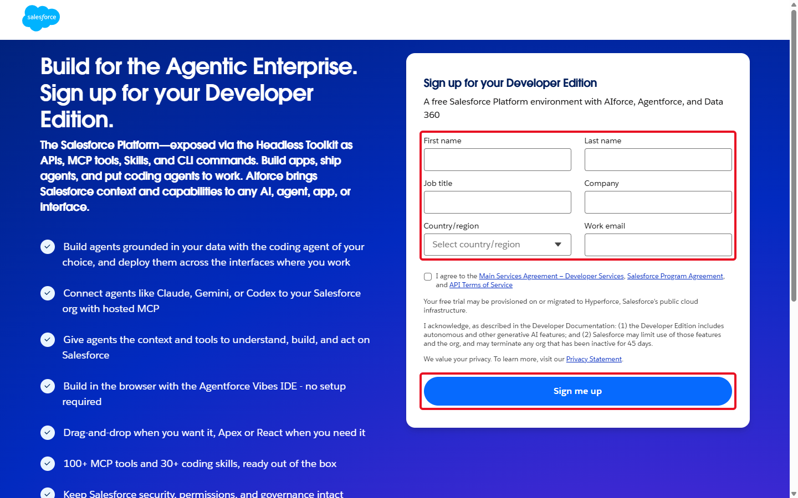

*Captured with Playwright before entering personal information. Form fields and offer wording can change.*

### Step 2: Activate and identify the org

1. Open the Salesforce verification or welcome email and follow its activation instructions.
2. Complete the account setup, including password and verification steps, yourself.
3. Sign into the org and wait for the Salesforce home page.
4. Select the gear icon, then **Setup**. Use the **Quick Find** box on setup pages to locate settings throughout this lab.
5. Search for **Company Information**. Record the **Salesforce Organization ID** and confirm that this is the developer org you just created.
6. Search for **My Domain**. Copy the **Current My Domain URL**, for example `https://your-lab-org.develop.my.salesforce.com`.

Use the actual URL shown in your org. Do not substitute `https://login.salesforce.com`, a Lightning page URL, or a URL with a `/lightning/...` path.

> **Checkpoint.** You can open Setup as System Administrator in a free Developer Edition org, and you have recorded its org ID and Current My Domain URL.

---

## Exercise 2: Prepare Salesforce for Agent 365

Follow the [Microsoft Salesforce connection guide](https://learn.microsoft.com/microsoft-agent-365/admin/connected-platforms-salesforce-agent-force) and [Salesforce org setup guide](https://developer.salesforce.com/docs/ai/agentforce/guide/org-setup.html). Prepare tracing now, before running conversations, so the org supports both inventory synchronization and activity collection.

### Step 1: Provision Data 360

1. In **Setup**, search for **Data 360 Setup**. If the org uses the old label, search for **Data Cloud Setup**.
2. Open the page. If Data 360 is not set up, select **Get Started** and complete the provisioning prompts for the developer org.
3. Wait until provisioning finishes. Microsoft's guide notes that this can take up to an hour.
4. Open the **App Launcher** and confirm that the **Data 360** (or **Data Cloud**) app is available.

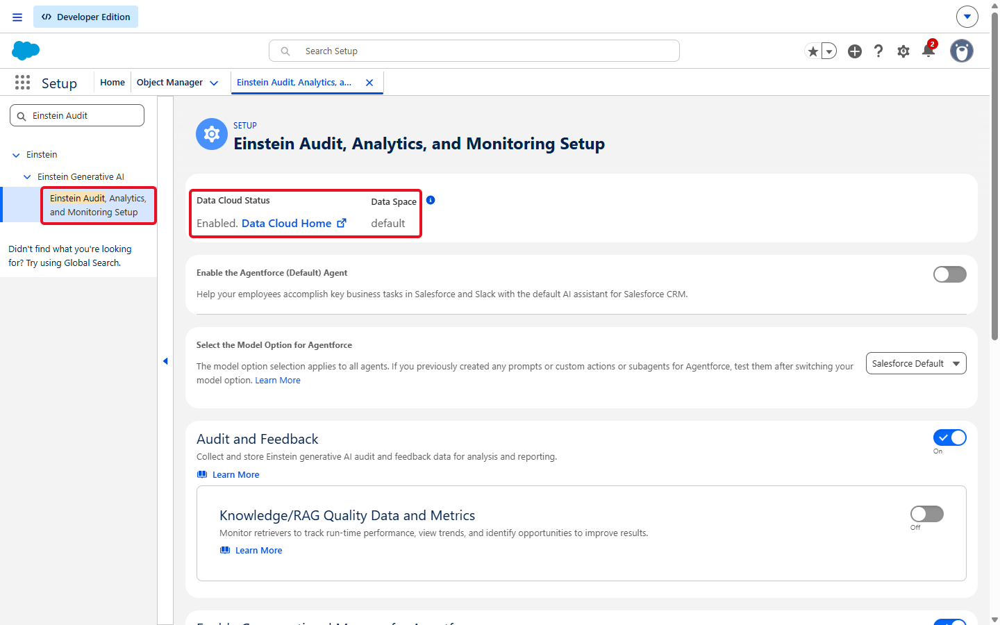

*After provisioning, search Quick Find for **Einstein Audit** to use this page as a readiness check: Data Cloud Status should be **Enabled** and the data space **default**.*

Do not continue past a provisioning error. Data 360 is required for the Salesforce Trust Layer setup and Agentforce session tracing; an org without it is not ready for the full lab.

### Step 2: Enable Einstein and Agentforce

1. Return to **Setup** and search for **Einstein Setup** or **Einstein Generative AI**.
2. Open Einstein Setup and enable **Turn on Einstein**, if it is off.
3. Review **Einstein Trust Layer** settings with your facilitator and retain the protections required by your organization. Do not disable protections to make the lab work.
4. Search for **Agentforce Agents** and open it.
5. Turn on **Agentforce**, if it is off. Refresh the page if the agent creation controls do not appear immediately.
6. Confirm that **New Agent** is available here or in the **Agentforce Studio** app.

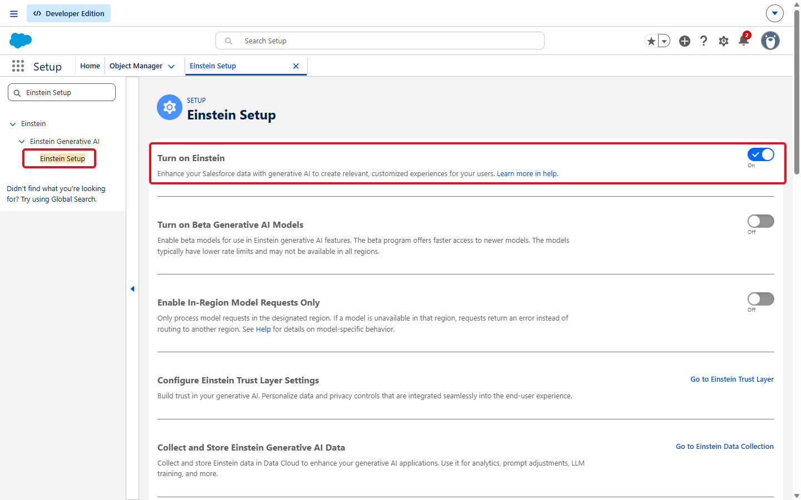

### Step 3: Enable session tracing

1. In **Setup**, search for **Installed Packages**.
2. Confirm that **Salesforce Standard Data Model** is at version **1.130 or later**. If it is older, have the Salesforce administrator follow [Set Up Agentforce Session Tracing](https://help.salesforce.com/s/articleView?id=ai.generative_ai_session_trace_setup.htm&type=5) to upgrade it before proceeding.
3. Search for **Einstein Generative AI** and open **Einstein Audit, Analytics, and Monitoring Setup**.
4. Turn on **Agentforce Session Tracing**. If prompted for a data space, select **default**.
5. Turn on **Agent Platform Tracing** and **Audit and Feedback**.
6. Confirm that the settings remain enabled after saving or refreshing the page.

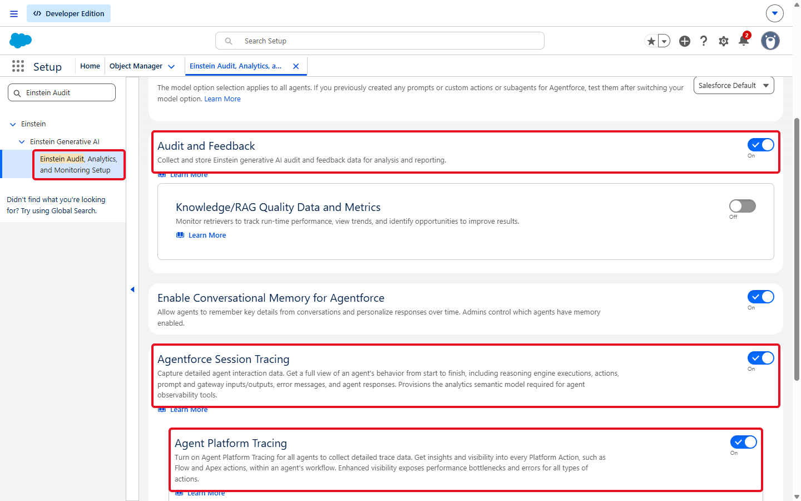

*Check the switch under each heading: some switches reuse the accessible label Audit and Feedback, while the platform-tracing switch is labelled Platform Traces.*

Sessions run before tracing is enabled are not recorded and cannot be collected retrospectively. Inventory discovery and activity collection are separate outcomes: you will verify discovery in Exercise 5, and optionally verify sessions afterward.

### Step 4: Create an external client app

1. In **Setup**, search for **External Client App Manager** directly. Microsoft's guide also starts from a search for **App Manager**.
2. Select **New External Client App**.

   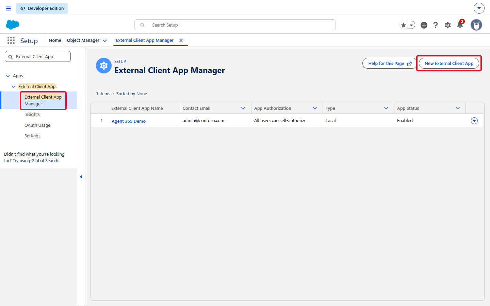

3. Enter **Agent 365 Lab Connector** as the app name and your lab administrator's contact email. If a distribution choice is shown, keep the app local to this developer org.
4. Expand **API (Enable OAuth Settings)**, then select **Enable OAuth**.
5. Set **Callback URL** to `https://login.salesforce.com/services/oauth2/success`.
6. Add every scope in this table to the selected OAuth scopes:

   | Display name | Scope |
   | --- | --- |
   | Access chatbot services | `chatbot_api` |
   | Access the Salesforce API Platform | `sfap_api` |
   | Manage user data via APIs | `api` |
   | Perform requests at any time | `refresh_token`, `offline_access` |

7. Under **Flow Enablement**, select **Enable Client Credentials Flow**. Read the confirmation explaining that anyone with the key and secret can access the org on behalf of the selected user; confirm only for this approved lab integration.
8. Select **Create** and wait for the app to appear.

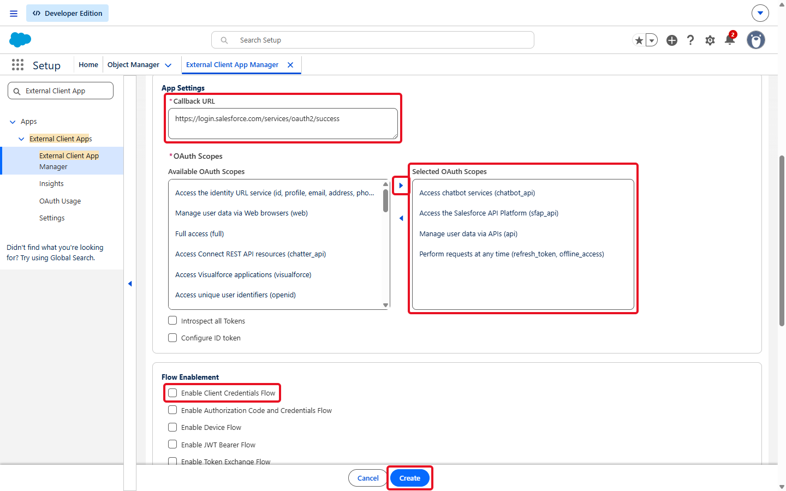

*Select each scope in Available OAuth Scopes, then use the right-arrow control to move it to Selected OAuth Scopes. The screenshot shows an unsaved form before **Enable Client Credentials Flow** is selected; you must still select it, confirm the prompt, and complete the policy step below.*

Use an **external client app**, not an unrelated connected-app tutorial with different scopes or authentication flows.

### Step 5: Configure the app's OAuth policy

1. Open the external client app and select its **Policies** tab.
2. Select **Edit**.
3. Under **OAuth Policies**, turn on **Enable Client Credentials Flow** here as well. Enabling it only during app creation is not sufficient.
4. Set **Run As** to an active Salesforce integration user with API access and access to the agents you will synchronize.
5. For this isolated developer-org lab, you can use the System Administrator account for **Run As**. Confirm that it can query the **default** Data 360 data space; where needed, an administrator can assign the **Data Cloud Architect** permission set (formerly **Data Cloud Admin**) and the applicable data-space access.
6. Select **Save**.

!!! warning "Integration identity versus agent runtime identity"
    **Run As** is the identity used by Agent 365 to read Salesforce inventory and tracing data. The dedicated **Einstein Agent User** created in Exercise 4 is the identity used by the Salesforce agent at runtime. They are different roles. A production connection should use a dedicated least-privilege integration user, not the developer org's administrator.

### Step 6: Collect connection credentials securely

1. Open the app's **Settings** tab and expand **OAuth Settings**.
2. Select **Consumer Key and Secret** and complete any verification Salesforce requires.
3. Copy the **consumer key** and **consumer secret** into an approved temporary secret store.
4. Retrieve the **Current My Domain URL** recorded in Exercise 1.
5. Close the credential display before taking screenshots.

The consumer key becomes the connector's client ID, and the consumer secret becomes its client secret. Do not include either in a published lab screenshot; never paste the secret into a coding-assistant conversation.

> **Checkpoint.** Data 360 is provisioned, Einstein and Agentforce are on, tracing is enabled for the default data space, and the external client app has all four scope entries, client credentials flow enabled in both places, and an authorized Run As user.

---

## Exercise 3: Connect Salesforce to Agent 365

Create the connection **before** creating your lab agent. This makes the later synchronization demonstrate discovery of a newly added agent.

### Step 1: Open Connected platforms

1. Open the [Microsoft 365 admin center](https://admin.microsoft.com/Adminportal/Home#/homepage).
2. Confirm that you are in the Agent 365-enabled Microsoft lab tenant.
3. Select **Agents** > **All Agents**.
4. Select **Manage connected platforms**. In some portal versions this appears as **Connected platforms** > **Manage**.

   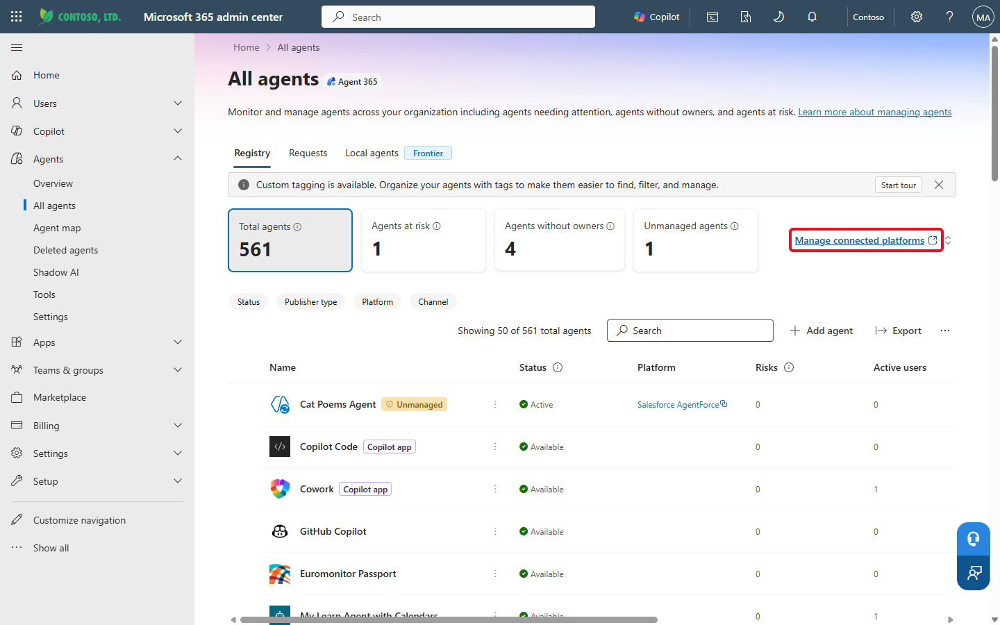

5. Select **Add connection**. Older versions use **+ Connect a platform**.

   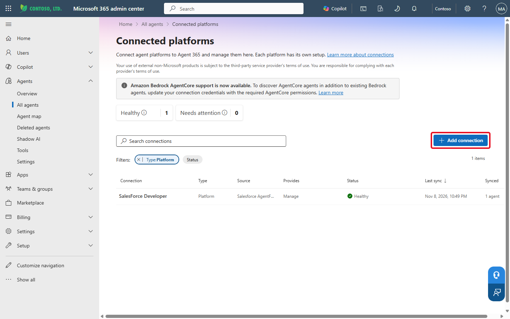

6. In **Connect a platform**, enter **Salesforce Lab** as **Name** and optionally enter a description.
7. Under **External platform**, choose **Salesforce AgentForce**.
8. For this lab, leave **Import agents automatically** set to **Never**. You will explicitly request each sync; this does not prevent manual synchronization.

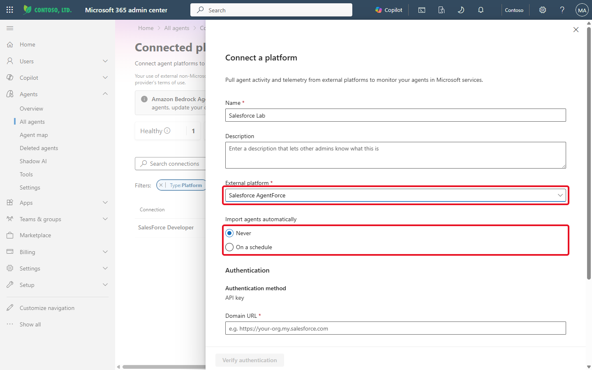

If the platform or management controls are missing, ask the facilitator to check Agent 365 onboarding, feature availability, and your administrator role before continuing.

### Step 2: Validate and save the connection

1. Enter the Salesforce **My Domain URL** in **Domain URL**, with the scheme and hostname but no path.
2. Enter the **Consumer Key** and **Consumer Secret** from the external client app.
3. Keep **Collect agent observability data** selected. New connections collect it by default; edit an older connection to enable collection if necessary.
4. Select **Verify authentication** (the credential validation control) and wait for success.
5. Complete the wizard to save the connection.
6. Open the saved connection and select **Sync agents**.
7. Wait for the synchronization result and record its status and time.

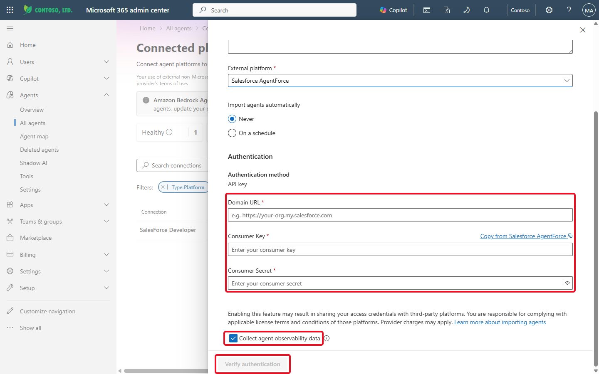

*The credential fields are deliberately empty in this screenshot. Verify authentication becomes available when required fields are filled.*

It is fine if this initial synchronization does not contain your lab agent: you have not created it yet. Existing sample agents may appear. Credential validation alone is not proof that inventory synchronization succeeded.

If validation fails, check the My Domain URL, both client credentials switches, **Run As**, and the user's access. A newly created external client app can take a few minutes to accept the flow.

> **Checkpoint.** The Salesforce connection is saved in the correct Microsoft tenant, credential validation passed, and you have recorded the initial synchronization result.

---

## Exercise 4: Create and activate an Agentforce agent

Create a small agent called **A365 Connected Platform Lab**. Its purpose is to demonstrate inventory discovery, not to deploy a customer-facing service or access business data.

### Step 1: Open the agent creation surface

1. Return to the **same Salesforce developer org**.
2. Open the **App Launcher**, search for **Agentforce Studio**, and open it. If your org uses the earlier experience, use **Setup** > **Agentforce Agents** instead.
3. Select **New Agent**. Agentforce Builder opens in a new browser tab.

   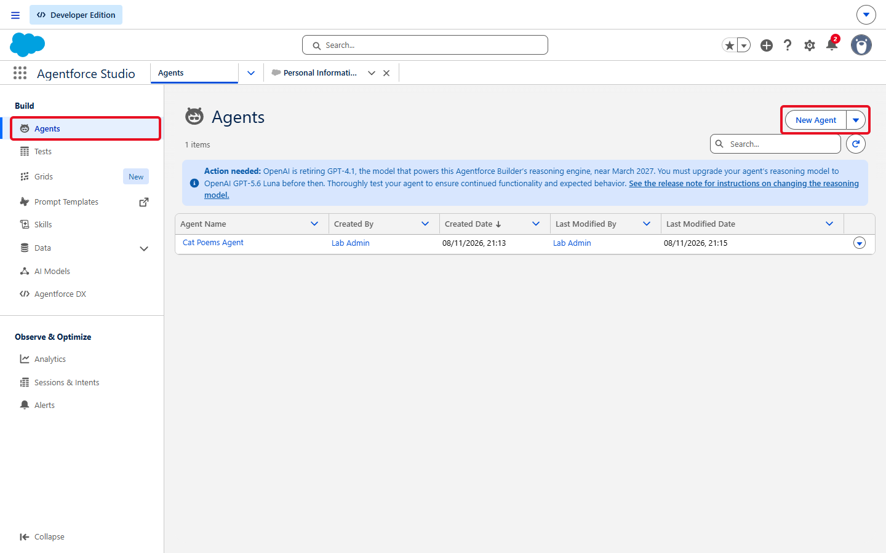

4. Under **Or, start with a template**, find **Agentforce Service Agent** and select **Select**. If the earlier wizard asks for an agent type, choose the same type.
5. In **Name your agent**, set **Agent Name** to **A365 Connected Platform Lab**. Keep the generated **Developer Name** and record it.
6. If the wizard asks for a description, role, or company, describe it as a service agent for an isolated administrator training lab and use **Agent 365 Training Lab** as the fictional company. The agent's descriptive role is not a Salesforce administrator permission assignment.

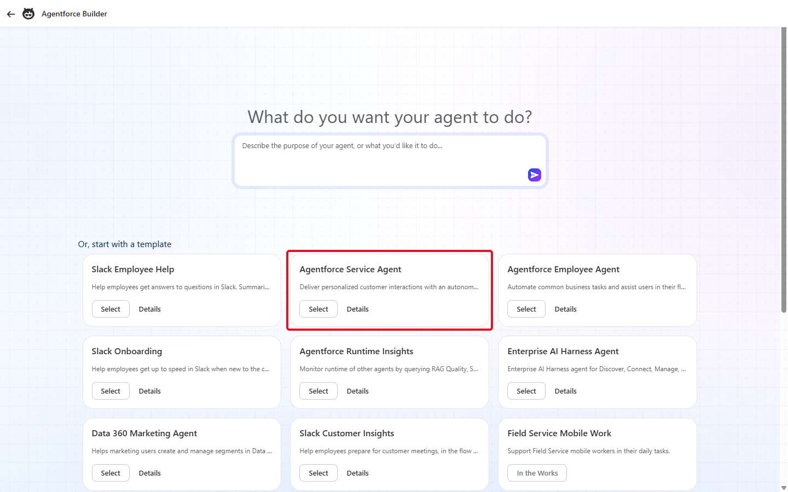

*The template path makes the agent type explicit rather than relying on the builder to infer it from a generated description.*

### Step 2: Assign a dedicated agent user

1. Find **Agent's User Record** or **Assign a user record to your agent to manage its access**.
2. If an appropriate dedicated Einstein Agent User already exists, choose **Select User** and select it.
3. Otherwise, use **New User** if the builder offers automatic provisioning.
4. If automatic user creation fails, do not repeatedly retry it or assume the licence pool is exhausted. Follow the CLI workaround below, then return to **Select User**.

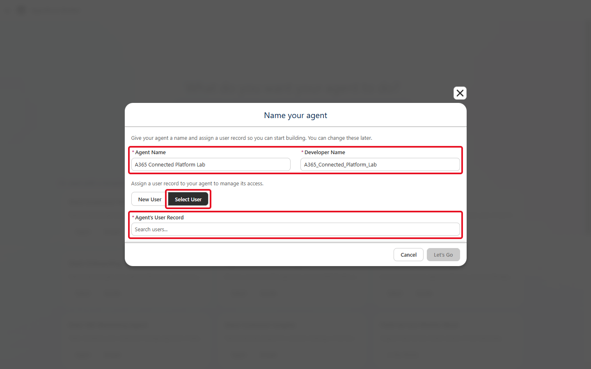

#### Workaround: Create the runtime user with Salesforce CLI

This workaround was needed in the author's developer org **even though all relevant licence pools had capacity**. That observation does not establish the root cause of every provisioning error. Salesforce's supported command bypasses Builder's automatic user-creation path and reports licence and permission failures explicitly.

1. Install the [Salesforce CLI](https://developer.salesforce.com/tools/salesforcecli) through your organization's approved software channel if necessary. Retain the machine's configured internal package registry/proxy; do not add public feeds to bypass an installation failure.
2. In PowerShell, confirm that the CLI includes the command:

   ```powershell
   sf --version
   sf org create agent-user --help
   ```

3. Sign into the **same developer org using your System Administrator account**:

   ```powershell
   sf org login web --alias agentforce-dev
   ```

4. Complete browser sign-in yourself. Before continuing, confirm the selected account belongs to the intended org; if you have several orgs, compare its My Domain URL and org ID with your lab notes.
5. Create the runtime user:

   ```powershell
   sf org create agent-user --target-org agentforce-dev
   ```

6. Record the generated username and user ID reported by the command. Do not rerun a successful command just to redisplay the result; that would create another user.
7. In Salesforce **Setup** > **Users**, open the generated user and confirm its **Einstein Agent User** profile.
8. Return to the builder's user-record step, choose **Select User** instead of **New User**, search for the created user, and select it.

According to the [official CLI reference](https://github.com/salesforcecli/plugin-org#sf-org-create-agent-user), the command creates a globally unique username, assigns the **Einstein Agent User** profile and the `AgentforceServiceAgentBase`, `AgentforceServiceAgentUser`, and `EinsteinGPTPromptTemplateUser` permission sets, and checks the required licence availability. The generated user has **no password** and cannot sign into Salesforce interactively.

If the command is unavailable, obtain an approved current CLI release. If it fails, retain the exact non-secret error and ask the Salesforce administrator to investigate provisioning, permissions, or the specific licence check reported. Do not assign the System Administrator profile to the runtime agent as a workaround.

### Step 3: Finish and activate the agent

1. Continue the creation wizard: select **Let's Go** in the newer builder or complete the remaining **Next**/**Create** steps in the earlier experience.
2. If offered optional guided configuration, use **Skip Ahead** to open the builder.
3. Review **Settings** and **Subagents** (or **Topics**) against the training-only purpose. Remove generated actions that modify records, send messages, or make bookings; do not add the Coral Cloud custom flows from the Trailhead example, which are not included in a fresh Developer Edition org.
4. In the newer builder, select the **+** beside **Subagents**, then **+ New Subagent**. In the earlier builder, create a topic in **Topics**.
5. Name it **Lab introduction**. For its description, enter `Handles questions about this agent's name, platform, and administrator training purpose.` Select **Create and Open** (or complete the earlier topic wizard).
6. In **Reasoning Instructions** (or the topic's instructions), enter:

   ```text
   Your name is A365 Connected Platform Lab.
   You run in Salesforce Agentforce.
   This is an isolated administrator training lab showing how Agent 365
   discovers Salesforce agents through Connected Platforms.
   Explain these facts when asked about your name, platform, or purpose.
   Do not retrieve customer data, change records, send messages, or make bookings.
   ```

7. Do not add data sources or actions to this introductory subagent/topic. Save it and resolve any required configuration or validation messages rather than bypassing them.
8. Save the agent. In the newer experience, select **Commit**, review the changes, and confirm **Commit** before activation.
9. Select **Activate** and confirm activation.
10. Return to **Agentforce Studio** or **Agentforce Agents** and confirm that **A365 Connected Platform Lab** is **active**. Record its name, Salesforce identifier, and active version where shown.

The [Salesforce Builder quick start](https://trailhead.salesforce.com/content/learn/modules/quick-start-assemble-a-service-agent-with-agentforce-builder/build-with-agentforce-builder) documents the newer creation, user selection, commit, activation, and preview flow. Its resort-specific sample data and actions are not prerequisites for this inventory lab.

You do not need to configure Embedded Service, a public website, messaging, Slack, or a routing flow to complete inventory discovery.

> **Checkpoint.** A365 Connected Platform Lab exists in Salesforce, uses a dedicated runtime user, and is active. A saved draft alone is not sufficient for the synchronization checkpoint.

---

## Exercise 5: Force synchronization and find the agent

### Step 1: Synchronize the existing connection

1. Return to the Microsoft 365 admin center in the **same Microsoft tenant**.
2. Open **Agents** > **All Agents** > **Manage connected platforms** (or **Connected platforms** > **Manage**).
3. Open the Salesforce connection created in Exercise 3.
4. Select **Sync agents**. This manually requests a synchronization; refreshing the browser page is not the same action.
5. Wait for synchronization to finish. Refresh or reopen the connection to inspect its result.
6. Confirm success and record the new synchronization time, which must be after the Salesforce agent's activation.

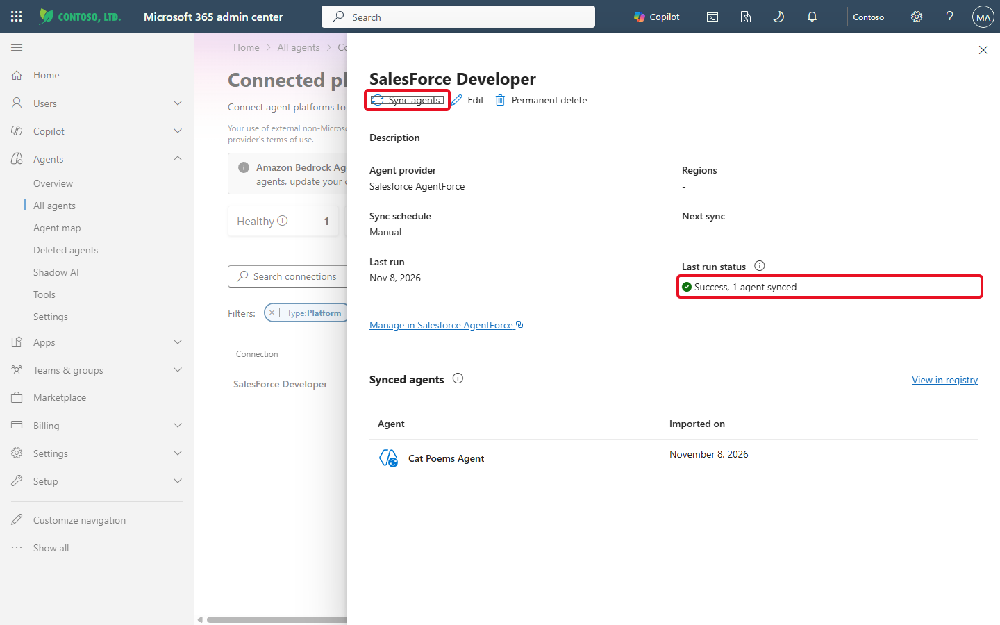

*This existing example shows Manual as the schedule and Success, 1 agent synced. Your agent name and connection name will differ.*

Do not create a second connection to force a refresh. If synchronization fails, inspect the connection's error before retrying.

### Step 2: Observe the imported agent

1. Inspect the agents associated with the Salesforce connection.
2. Locate **A365 Connected Platform Lab**.
3. Return to **Agents** > **All Agents** and search for the same name. Clear any filters that exclude third-party platforms.
4. Open the agent's details.
5. Confirm that its source/platform identifies **Salesforce Agentforce** and compare the name and any exposed external identifier with your Salesforce lab notes.


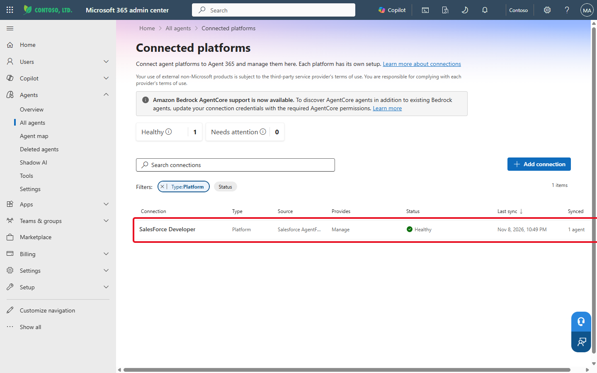

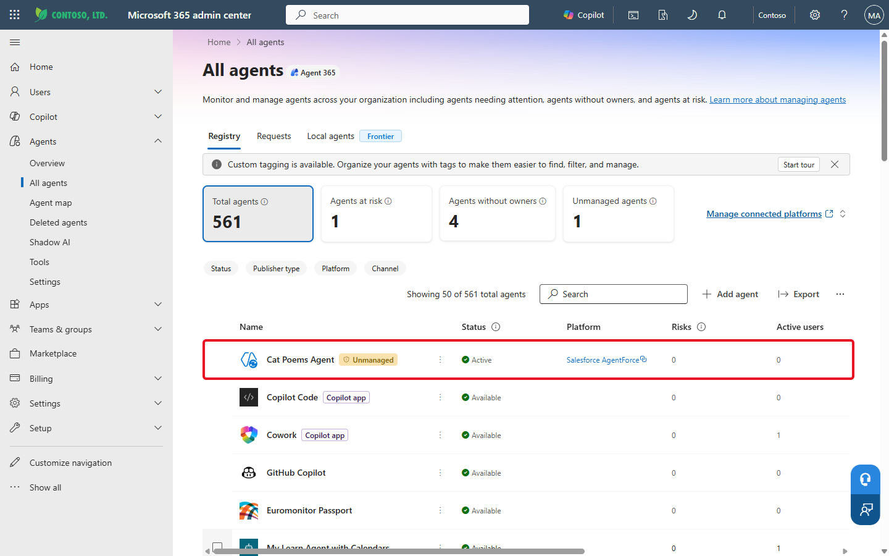

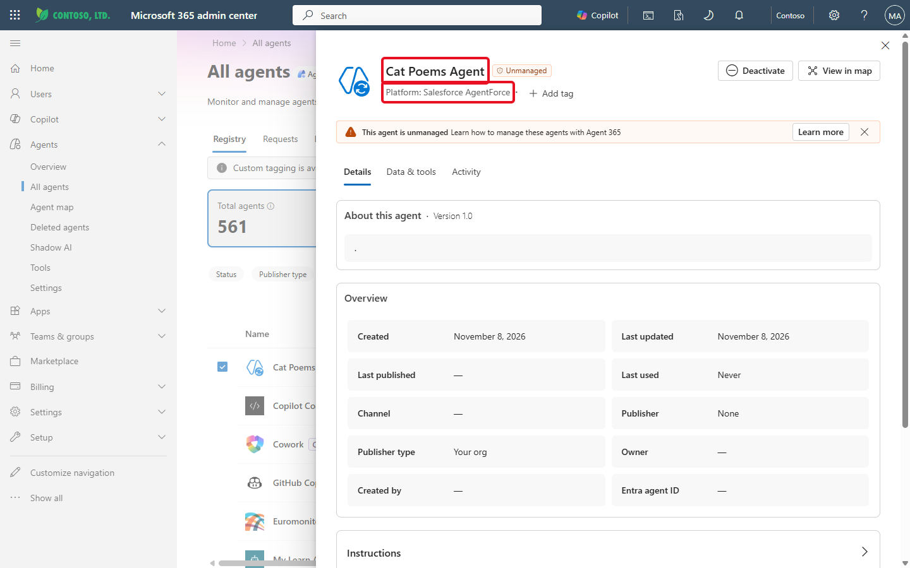

*The screenshots show the existing Cat Poems Agent example. An imported agent can be marked **Unmanaged** and have no **Entra agent ID**; discovery alone does not perform full Agent 365 identity onboarding. Do not treat that label as a synchronization failure.*

The agent shows up as "unmanaged". Thanks to the Salesforce observability capabilities, we are able to see the activity in the Microsoft Admin Center and traces in Defender. However, the agent isn't fully integrated in Agent 365: if you expand the **Identity**
section, you will see that the agent doesn't have a blueprint or an Entra ID.

If the agent is missing, first confirm that it is active in the connected Salesforce org, then check the external client's **Run As** user's access and sync again. Do not treat **Activity = 0** as an inventory-sync failure.

> **Checkpoint.** The manually synchronized Salesforce connection succeeded, and the new active agent appears in the Microsoft 365 admin center with Salesforce Agentforce as its source.

---

## Optional exercise: Observe a live session

The five core exercises are complete when the agent appears in inventory. This extension demonstrates why you enabled Data 360 and tracing earlier.

1. Open the active agent in Salesforce **Agentforce Builder**.
2. Open **Preview** and choose **Live Test** mode, not **Simulate**.
3. Submit `What is your name, and what is the purpose of this training agent?`
4. Confirm a response and record the session ID and time. Use only synthetic lab input: Live Test can access and modify real org data if the agent has such actions.
5. In the **Data 360** app, open **Data Explorer**.
6. Select the **default** data space, **Data Model Objects**, and **AI Agent Session**. Look for the row matching your session ID.
7. Once the session is available, return to the Salesforce connection in the Microsoft 365 admin center and select **Sync agents** again. Agent 365 collects new sessions each time the connection syncs.
8. Open the imported agent under **Agents** > **All Agents**, select **Activity**, and check that **Sessions** is at least **1**.

The first sessions after tracing is enabled can take **up to two hours** to reach Data 360. If necessary, open **Data Streams** in the Data 360 app, open each Agentforce session tracing stream, and select **Refresh Now**, then wait for the row and sync the Microsoft connection again.

**Active users** can show **N/A** because Agentforce sessions do not include Microsoft Entra identities.

## Troubleshooting

| Symptom | What to check or do |
| --- | --- |
| Agentforce or Data 360 is unavailable | Confirm the org is the current Developer Edition offering with both capabilities. Complete provisioning and Einstein/Agentforce enablement. Ask the facilitator if capacity or feature availability prevents progress. |
| Session tracing controls are unavailable | Confirm Data 360 is provisioned, Agentforce is on, and Salesforce Standard Data Model is at least 1.130. |
| External client credential validation fails | Use Current My Domain URL without a path; check the key/secret, client credentials flow in both settings and policies, and an active API-enabled Run As user. Allow a few minutes for a new app. |
| Builder cannot create an agent user | Use the supported CLI workaround in Exercise 4. Available licence capacity does not rule out provisioning or permission errors. Retain the actual error rather than guessing the cause. |
| CLI user creation fails | Check the exact licence or permission error, correct org alias, System Administrator sign-in, and approved CLI version. Do not repeatedly create users or grant blanket administrator access. |
| Sync succeeds but the agent is missing | Confirm the correct Salesforce org is connected, activate the agent, check Run As access, and manually sync after activation. Clear inventory filters. |
| Agent appears but Activity has no sessions | Confirm collection is enabled, run a new Live Test conversation after tracing is on, check the default data space, wait for Data 360 ingestion, and sync again. |
| Session exists in Data 360 but not Activity | Check Run As data-space/query permissions, collection setting, and a sync after the session became available. Also check applicable Activity viewer entitlements. |

## Completion and cleanup

You have completed **Lab A365-01B** when the active Salesforce agent appears in the Microsoft 365 admin center after a manual synchronization. Keep the agent name, source, and successful sync time as evidence. Record partial completion if a prerequisite or synchronization error blocks that result; do not use a screenshot of the Salesforce builder as proof of Microsoft inventory discovery.

If you took the optional extension, also keep the matching Salesforce session ID and admin center session count.

When the facilitator no longer needs the integration, have the authorized administrators remove the Connected Platforms connection and revoke Salesforce access by disabling/deleting the external client app or rotating its consumer secret. Deactivate the lab agent if it is no longer needed. If you used the CLI, sign out of the local authorization when finished with `sf org logout --target-org agentforce-dev` and confirm the prompt. Do not remove a shared connection or user used by other participants.

Next, complete the [SDK requirements](./00-prerequisites.md), then continue to the [.NET lab](./02a-web-obo-dotnet.md).

## References

- [Salesforce Developer Edition signup](https://developer.salesforce.com/signup)
- [Developer Edition with Agentforce and Data Cloud announcement](https://developer.salesforce.com/blogs/2025/03/introducing-the-new-salesforce-developer-edition-now-with-agentforce-and-data-cloud)
- [Microsoft: Connect Salesforce Agentforce to Agent 365](https://learn.microsoft.com/microsoft-agent-365/admin/connected-platforms-salesforce-agent-force)
- [Salesforce: Set Up Einstein Generative AI and Agentforce](https://developer.salesforce.com/docs/ai/agentforce/guide/org-setup.html)
- [Salesforce: Set Up Agentforce Session Tracing](https://help.salesforce.com/s/articleView?id=ai.generative_ai_session_trace_setup.htm&type=5)
- [Salesforce: Create a service agent with Agentforce Builder](https://trailhead.salesforce.com/content/learn/modules/quick-start-assemble-a-service-agent-with-agentforce-builder/build-with-agentforce-builder)
- [Salesforce CLI: sf org create agent-user](https://github.com/salesforcecli/plugin-org#sf-org-create-agent-user)

<cc-next label="Continue to SDK requirements" url="../00-prerequisites/"></cc-next>
